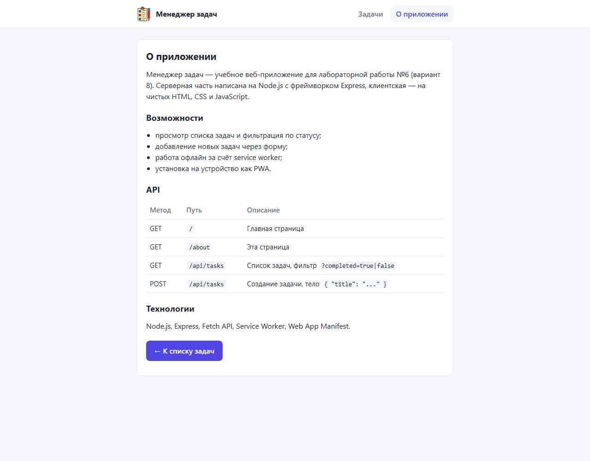

# Менеджер задач — лабораторная работа №6

Лёгкий менеджер задач в формате PWA, который можно установить на устройство как обычное приложение. Он решает проблему потери доступа к списку дел при нестабильном или отсутствующем интернете: интерфейс и сохранённые задачи открываются офлайн, их можно фильтровать по статусу и добавлять новые локально (без синхронизации с сервером).

## Возможности

- **Просмотр и фильтрация задач** — быстрый отбор по статусу выполнения прямо в интерфейсе.
- **Добавление новых задач** — создание задач на лету; при отсутствии связи они сохраняются локально в браузере.
- **Офлайн-режим** — Service Worker кэширует статические ресурсы приложения, поэтому интерфейс остаётся доступным даже при остановленном сервере.
- **Установка как PWA** — благодаря Web App Manifest и иконкам приложение можно установить на рабочий стол или экран смартфона.
- **Страница «О приложении»** — краткая справка о проекте и его возможностях.

## Как устроено хранение данных

- **На сервере (Express):** задачи хранятся в оперативной памяти до перезапуска сервера.
- **В браузере (`localStorage`):** локально добавленные задачи сохраняются на устройстве пользователя и доступны без подключения к серверу.
- **В кэше (Service Worker):** HTML, CSS, JavaScript и иконки кэшируются для мгновенной загрузки и работы офлайн.

## Технологии

- **Backend:** Node.js, Express
- **Frontend:** HTML, CSS, JavaScript, Fetch API
- **PWA и хранение:** Service Worker, Web App Manifest, `localStorage`

## Запуск

Установите Node.js, затем в папке проекта выполните:

```sh
npm install
npm start
```

После запуска откройте в браузере `http://localhost:3000`.

### Проверка офлайн-режима и установки

1. Откройте приложение с работающим сервером, чтобы Service Worker успел закэшировать ресурсы.
2. Остановите сервер в терминале и обновите страницу — интерфейс и сохранённые задачи продолжат открываться.
3. При необходимости установите приложение через меню браузера (кнопка установки PWA в адресной строке).

## Скриншоты

Главная страница:


О приложении:


