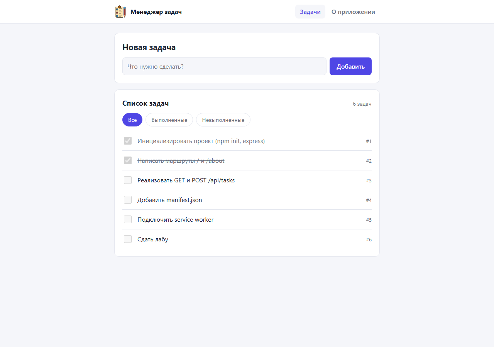

# Менеджер задач — лабораторная работа №6

Учебное PWA для просмотра, фильтрации и добавления задач. Без сервера показывает сохранённый список и позволяет добавлять задачи локально, без синхронизации.

## Технологии

Node.js, Express, HTML, CSS, JavaScript, Fetch API, Service Worker, Web App Manifest и localStorage.

## Запуск

Установите Node.js, затем в папке проекта выполните:

```sh
npm install
npm start
```

Откройте http://localhost:3000. Для проверки офлайн сначала загрузите страницу с работающим сервером, затем остановите сервер и обновите страницу. PWA можно установить через браузер.

Серверные задачи хранятся в памяти до перезапуска; локальные — в браузере.

## Скриншоты

Главная страница:



О приложении:


